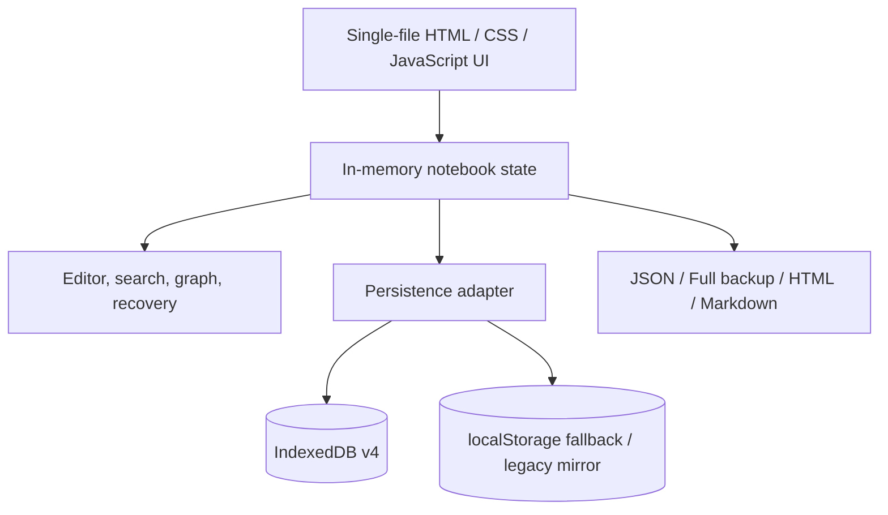

# Advanced Enhanced Notes Studio

**A private, offline-first notebook and visual knowledge workspace — built with HTML, CSS and JavaScript.**


Advanced Enhanced Notes started as a lightweight rich-text notes application. **Studio v4.0** extends it into a connected personal knowledge workspace with wiki-style links, a knowledge graph, research templates, flexible search, recoverable editing and a transactional browser database.

Everything runs locally. There is **no required account, cloud API, server-side database or build step**. The optional local launcher serves the same standalone HTML from a stable browser origin to make browser storage more predictable.

> [!IMPORTANT]
> **Before upgrading from an earlier version, export a Full backup.** V4 introduces IndexedDB, but storage belongs to a particular browser profile and origin. Opening a file with `file://` is **not** the same storage location as opening it through `http://127.0.0.1:8765`. See [Migrating safely](#migrating-safely).


## Highlights

| Capability | What it provides |
| --- | --- |
| **Rich-text notes** | Formatting, headings, lists, block quotes, links, fonts, text colour and note colours. |
| **Connected knowledge** | `[[Wiki links]]`, backlinks, a navigable knowledge graph, related-note suggestions and link diagnostics. |
| **Powerful discovery** | Live search, search operators, tag filters, sorting, pinned/favourite/archived views and a command palette. |
| **Safe writing workflow** | Autosaved drafts, a saved-draft shelf, edit history, undo/redo, Trash and restoration. |
| **Practical workflows** | Research, project, meeting, journal and brainstorming templates; bulk note actions; writing insights. |
| **Portable data** | JSON, readable HTML and Markdown exports, plus a full backup containing note metadata and recovery data. |
| **Local-first storage** | Transactional IndexedDB when available; compatible `localStorage` fallback and best-effort legacy mirror. |
| **Usability** | Responsive interface, light/dark themes, focus mode, keyboard controls and optional typing effects. |

### Connected notes

Link one note to another using the editor's **`[[ Note ]]`** button, or type:

```text
[[Project roadmap]]
[[Research methods]]
```

The app resolves these links locally, exposes backlinks and visualises connected notes in its **Knowledge map**. Related-note recommendations are based on local word and tag similarity — **not an external AI model**. The link-health tool helps identify unresolved references and ambiguous titles.

### Advanced search

The ordinary search box supports title, tag and body-text matching. Use operators for structured queries:

```text
tag:research
is:pinned
title:prototype
after:2026-01-01
has:link
-tag:old
color:blue
is:orphan
```

Other available operators include `body:`, `before:` and statuses such as `is:favorite`, `is:archived`, `is:active` and `is:linked`. Date filters are based on the **note's creation date**; `after:` and `before:` use strict date comparisons. Combined operators narrow results.

## Getting started

### Option A — open the standalone HTML

1. Download or copy `Advanced_Enhanced_Notes_v4.html`.
2. Open it in a modern browser.
3. Create a note, save it and check **Storage & recovery** to see which storage engine is active.

No installation or internet connection is required. However, browsers may restrict IndexedDB for `file://` pages and treat local files as separate storage origins. **Option B is recommended when you want repeatable local persistence.**

### Option B — stable local origin (recommended)

Requires **Python 3** only for the local server; the app itself remains dependency-free.

**Windows:** Extract the release package and double-click:

```text
Launch_Notes_v4_Windows.bat
```

**Windows, macOS or Linux terminal:** From the extracted folder, run:

```bash
python serve_notes.py
```

Open:

```text
http://127.0.0.1:8765/Advanced_Enhanced_Notes_v4.html
```

The provided Python server binds to `127.0.0.1` (your machine only), uses the standard library and does not require internet access. Keep the terminal running while using the site. On later visits, use the **same hostname, port and browser profile** so your browser can find the same notebook.

> **Port warning:** Changing from `8765` to another port creates a different browser origin. It does **not** move existing notes automatically.

## Migrating safely

These steps matter especially when moving from v2, v3, v3.1 or v3.2:

1. **Back up first.** Open the old version where your notes currently appear and use **Full backup** to export JSON. Keep that file outside browser storage.
2. **Keep the old version.** Do not overwrite or discard the old HTML file or backup yet.
3. **Open v4 consistently.** Prefer the provided localhost launcher and stick with one browser profile and port.
4. **Import when needed.** Click **Import** and select your earlier full-backup JSON. Use **Merge** to add imported notes; use **Replace** only when you intend to replace the current v4 notebook.
5. **Verify persistence.** Create a temporary note, wait for **IndexedDB · Saved** when that engine is active, then close and reopen v4 at the same origin. Confirm the note is still present.
6. **Run a data check.** In **Storage & recovery**, select **Verify data**. Export a new full backup before relying on v4 as your only copy.

On first launch **within the same origin**, v4 can migrate earlier `localStorage` notes, Trash, histories and saved drafts into IndexedDB. The original keys are retained. **This is not cross-origin migration**: use an exported backup when switching from `file://` to localhost, changing ports or changing browser profiles.

## Everyday use

**Create and edit:** Enter a title, tags and content; choose formatting and save. Notes support inline edits and full-composer editing.

**Organise:** Assign up to 12 tags, pin or favourite notes, colour-code them, archive older notes and sort or manually reorder them.

**Recover:** Delete sends notes to **Trash**. Restore them there or empty Trash when you want permanent removal. Up to **10 previous versions per note** are retained for editing history.

**Keep work in progress:** Draft content autosaves. **Park draft** stores an unfinished editor session in the saved-draft shelf so you can switch tasks without silently discarding it.

**Work in batches:** Select multiple notes to apply supported bulk actions; notebook undo/redo is available for many changes within the current session.

**Explore:** Use **Open graph** for relationships, **Link health** for unresolved links, **Writing insights** for recent writing activity and the **Command palette** for quick navigation.

### Keyboard shortcuts

| Shortcut | Action |
| --- | --- |
| `Ctrl/Cmd + S` | Save the current note or inline edit |
| `Ctrl/Cmd + Shift + K` | Open command palette |
| `Ctrl/Cmd + K` | Focus note search |
| `Ctrl/Cmd + Z` | Undo notebook change when outside editable fields |
| `Ctrl/Cmd + Y` / `Ctrl/Cmd + Shift + Z` | Redo notebook change when outside editable fields |
| `Ctrl/Cmd + B`, `I`, `U` | Bold, italic, underline while editing (browser-dependent) |
| `Esc` | Dismiss a dialog or exit focus mode |

For quick structure while composing, type `#`, `##` or `###` followed by a space for headings, `-` followed by space for bullets, or `1.` followed by space for a numbered list.

## Import, export and backups

| Operation | Purpose |
| --- | --- |
| **Export JSON** | Portable export of notes. |
| **Export HTML** | Readable document containing exported notes. |
| **Markdown** | Plain-text-friendly notebook export. |
| **Full backup** | Portable snapshot including notes, Trash, version history and saved drafts. |
| **Import** | Import compatible JSON with explicit Merge or Replace choices. |
| **Export v3 copy** | Inspect/export the previous browser-storage mirror when available. |

Imports are validated and HTML content is sanitised. V4 accepts JSON files up to **64 MiB**, with a **12,000-note validation limit**. Those limits are safeguards, not performance guarantees.

**Backups are essential.** Browser data can be cleared, evicted, corrupted or made inaccessible by changing browser profiles/origins. Use **Full backup** regularly and keep copies somewhere outside the browser. A JSON export is **not** a password-protected or encrypted archive.

## Architecture



### Storage model

When supported by the browser, v4 opens database `AdvancedEnhancedNotesStudio.v4` (schema version `1`) with these object stores:

| Object store | Contents |
| --- | --- |
| `notes` | Active and archived note records |
| `trash` | Deleted notes pending permanent removal |
| `versions` | Per-note history records |
| `draftShelf` | Saved unfinished drafts |
| `meta` | Order arrays, database revision and current draft |

Database writes compare the previous and current notebook snapshots and update changed records in a single transaction. A revision check blocks conflicting commits rather than silently overwriting newer database state. V4 also attempts to maintain a legacy-compatible browser-storage mirror, **but that mirror is best effort and may be stale or absent when storage fills**.

For large result sets (**more than 600 notes**), the app progressively renders cards in groups of **240**; searching and sorting continue across the complete in-memory notebook.

### Security and privacy

- Notes are stored locally in your browser profile; there is no built-in server account or cloud synchronisation.
- The provided localhost launcher binds only to the loopback interface.
- Rich HTML and imported content are sanitised, and web/email links are restricted to supported safe schemes.
- **Local browser data is not encrypted by the application.** Anyone with access to your browser profile or exported files may be able to read the notes.
- The app is not designed for collaborative editing, sensitive-secret storage or guaranteed disaster recovery.

## Running tests

The release package includes a small Playwright smoke test and a simulated IndexedDB implementation.

From the extracted package directory:

```bash
python -m pip install playwright
python -m playwright install chromium
python tests/test_v4_smoke.py
```

The suite checks interface compatibility and core operations under Chromium. Its IndexedDB checks use an **in-memory test double**; they **do not certify native IndexedDB durability** or persistence across real browser restarts. Before treating v4 as fully validated, independently test migration, note reload, backup round trips, cross-tab conflicts and storage failures on the browsers you actually use.

## Project layout

```text
.
├── README.md                              # This file
├── Advanced_Enhanced_Notes_v4.html        # Complete application (standalone)
├── Advanced_Enhanced_Notes_v4_preview.png # Application screenshot
├── Advanced_Enhanced_Notes_v3_2.html      # Previous-version fallback
├── Advanced_Enhanced_Notes_v4_RELEASE_NOTES.md
├── Advanced_Enhanced_Notes_v4_QUICK_START.md
├── Launch_Notes_v4_Windows.bat            # Optional Windows launcher
├── serve_notes.py                         # Optional loopback HTTP server
└── tests/
    ├── test_v4_smoke.py
    └── fake_indexeddb_test.js
```

The standalone HTML can be distributed independently. The optional launcher, tests and backup copy are supplied in the full release package.

## Current limitations and roadmap

V4 is the most feature-rich release in this series, **not a guarantee of production-grade durability**.

- **Native IndexedDB verification is incomplete.** The release's database integration tests used a simulation; persistence across real reloads and crashes still needs independent testing.
- **Editing still uses some `document.execCommand` operations.** Modern Selection/Range fallbacks cover common operations but do not fully replace browser editing behaviour or undo semantics.
- **No multi-device sync or real-time collaboration.** Storage is tied to one browser origin/profile, with conflict detection rather than automatic merging.
- **No built-in encryption, attachments or AI embeddings.** Related-note suggestions use lexical heuristics and tags.
- **Limited browser matrix.** Core workflows were tested in Chromium; Firefox, Safari, iOS and long-duration stress testing remain work to do.

Potential next steps: native IndexedDB integration tests, durable migration tooling, richer editor architecture, lazy database-backed queries, optional encrypted exports and fully local semantic search. These are **planned ideas, not features in v4.0**.

## Troubleshooting

<details>
<summary><strong>My previous notes are missing.</strong></summary>

Confirm you're using the same browser, profile, hostname and port as before. `file://` and localhost do not automatically share storage. Open the previous version in its original context, export **Full backup**, then import it into v4.
</details>

<details>
<summary><strong>The storage panel says fallback or database unavailable.</strong></summary>

Your browser may not permit IndexedDB for this origin, especially when opened directly as a file. Try the stable localhost launcher and check the **Storage & recovery** status. The fallback can still store notes, subject to browser storage limits.
</details>

<details>
<summary><strong>I see a revision conflict or save error.</strong></summary>

**Do not refresh or close immediately.** Export a **Full backup** of the current tab first. Another tab may have updated the database, or storage may be unavailable. Reconcile changes only after securing both copies.
</details>

<details>
<summary><strong>Can I run it without installing Python?</strong></summary>

Yes. Open the standalone HTML file directly. Python is only for the optional local launcher that provides a consistent browser origin.
</details>

## Documentation

- [Quick start](Advanced_Enhanced_Notes_v4_QUICK_START.md)
- [Technical release notes and validation details](Advanced_Enhanced_Notes_v4_RELEASE_NOTES.md)
- [MDN — IndexedDB API](https://developer.mozilla.org/en-US/docs/Web/API/IndexedDB_API)
- [MDN — localStorage and file-origin considerations](https://developer.mozilla.org/en-US/docs/Web/API/Window/localStorage)

---

**Advanced Enhanced Notes Studio v4.0** · Local-first personal knowledge management · Built for experimentation, privacy and portability.

*Licensing:* No licence file is included in the v4 release package. Add an explicit `LICENSE` file before offering the project under a particular open-source licence.
